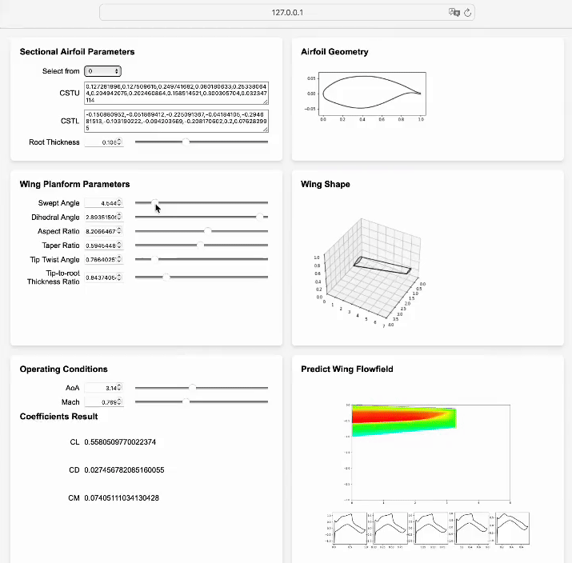

# FloGen

FlowGen is a universal flowfield generator based on machine learning and implentmented in Pytorch. 
- It differs from other data-driven flowfield generators that it introduce **physics knowledge** to enhance the predicting accuracy and generaliztion capability. 
- It has been applied to the prediction of airfoil, [wing](#web-wing---interactive-transonic-wing-design-app) and single expansion ramp nozzle (SERN).
- It is successfull applied to gradient-free optimization and gradient-based optimization (with utilizing back-propagation) tasks such as optimizing transonic buffet onset and multi-design-point fluidic injection parameters.

You can find the documentation of flowGen [here](https://flogen.readthedocs.io/en/latest/).

**Author:** 

- Yunjia Yang, Tsinghua University (2020-2025), Technical University of Munich (2025-), yyj980401@126.com

**Thanks to:** 

- Runze Li
- Mengxin Liu and Weishao Tang, for wing dataset estabilishment
- Yuqi Cheng, UI for Webwing

**Citation:**

- Multipoint airfoil flow field prediction
    ```
    Yang, Yunjia, Runze Li, Yufei Zhang, and Haixin Chen*. 2022. “Flowfield Prediction of Airfoil Off-Design Conditions Based on a Modified Variational Autoencoder.” AIAA Journal 60 (10): 5805–20. https://doi.org/10.2514/1.J061972.
    ```

- Multipoint airfoil shape optimization
    ```
    Yang, Yunjia, Runze Li, Yufei Zhang, and Haixin Chen*. 2024. “Fast Buffet-Onset Prediction and Optimization Method Based on Pretrained Flowfield Prediction Model.” AIAA Journal 62 (8): 2979–95. https://doi.org/10.2514/1.J063634.

    Yang, Yunjia, Runze Li, Yufei Zhang, and Haixin Chen*. 2026. "Uncertainty-aware data-based method for fast and reliable shape optimization." Structural and Multidisciplinary Optimization 69 (4): 95. https://link.springer.com/10.1007/s00158-026-04259-0.
    ```

- Wing flow field prediction
    ```
    Yang, Yunjia, Runze Li, Yufei Zhang, Lu Lu, and Haixin Chen*. 2024. “Transferable Machine Learning Model for the Aerodynamic Prediction of Swept Wings.” Physics of Fluids 36 (7): 076105. https://doi.org/10.1063/5.0213830.

    Yang, Yunjia, Runze Li, Yufei Zhang, Lu Lu, and Haixin Chen*. 2025. "Rapid aerodynamic prediction of swept wings via physics-embedded transfer learning." AIAA Journal 63 (6): 2545-59. 

    Yang, Yunjia*, Babak Gholami, Caglar Gurbuz, Mohammad Rashed, Nils Thuerey. 2026. "Towards a Foundation-Model Paradigm for Aerodynamic Prediction in Three-dimensional Design." Accepted by AIAA Journal.
    ```


## Datasets

The flowfield datasets to train all of our models are available upon request. Please see our [THIS HUGGINGFACE REPO](https://huggingface.co/datasets/yunplus/SuperFoil) for airfoil datasets and [THIS HUGGINGFACE REPO](https://huggingface.co/datasets/yunplus/SuperWing) for wing datasets.


## Applications

### Web-wing - Interactive Transonic Wing Design App

The physics-embedded transfer learning for transonic wing is demonstrated with a simple interactive app at [TUM website](https://webwing.pbs.cit.tum.de/). You can modify the airfoil geometry, wing planform geometry, and wing operating conditions to see what will happen on the wing surface flow field. Feel free to play with it, and your knowledge on wing aerodynamics will grow.

You can also locally deploy it, and you can find how to do it [here](https://github.com/YangYunjia/webwing).

The next step of the app is a gradient optimization tool for wing performance, which will come soon.

